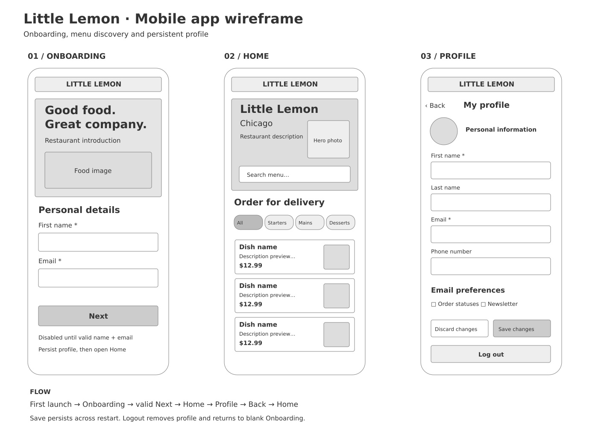

# Little Lemon Food Ordering App

React Native / Expo capstone project by Sultan Moldash. Built for Android, iOS and a web preview from one React Native codebase.



## Run the app

Use Node.js 22.13+ or a newer LTS release supported by Expo SDK 58.

```sh
npm ci
npm start
```

Scan the QR code with an Expo Go version that supports SDK 58, or press `a` for a configured Android emulator. An iOS simulator requires macOS. An incompatible Expo Go installation can instead use a matching Expo development build.

To run the same React Native UI in a browser:

```sh
npm run web
```

To create a static web build:

```sh
npm run build:web
```

The exported `dist/` folder can be hosted by any static HTTP server. No API keys, backend or paid service are required.

## Reviewer checklist

1. First launch: onboarding appears. **Next** stays disabled for an empty name or malformed email. Enter `Alex` and `alex@example.com`, then press Next.
2. Home has the branded header, restaurant description, hero image, search, selectable categories and a summarized food menu.
3. Select **Desserts**: only Lemon Dessert remains. Search for `pasta` while Desserts is active: the empty state appears. Reset filters, then search `FETA`: Greek Salad matches. Search and category filtering combine.
4. Open **Profile** using the initials avatar. The onboarding name and email are already populated.
5. Change the surname, phone and notification switches. **Save changes**, navigate back and restart the app. Saved values remain. **Discard changes** resets only the unsaved draft.
6. Use the Back button from Profile, a dish or the cart. A React Navigation native stack preserves the previous screen.
7. **Log out** removes the complete stored profile, resets notification preferences and clears the in-memory cart. Onboarding reappears with empty inputs, including after restarting.
8. Optional: open a dish, change quantity, add it to the cart, remove an item, or place a **demo order**. No payment occurs and no restaurant receives an order.

## Persistence and network behavior

- AsyncStorage stores one versioned profile object. Navigation changes only after storage succeeds; failures display a retry message.
- The menu loads from Meta's public course API and is cached. Bundled JSON and local photos keep the menu usable offline.
- Cart state is intentionally session-only. Checkout is an explicitly labeled demonstration.
- Notification switches demonstrate persistence only. No emails or passwords are managed.
- Profile information stays in local device/browser storage. AsyncStorage is not encrypted and this prototype is not intended to store sensitive data.

## Project structure

- `App.js`: Onboarding, Home, Profile, dish detail and cart screens, stack navigation, storage and menu hydration.
- `logic.mjs`: validation, combined menu filtering and totals.
- `logic.test.mjs`: executable tests for validation, filtering and totals.
- `menu-source.json`: bundled fallback menu.
- `wireframe.jpg` and `wireframe.svg`: original wireframe and editable source, matching the three required screens.
- Local `.jpg` files: menu and hero photos.

## Validation

```sh
npm test
npm run build:web
```

The browser interaction flow also checks onboarding, invalid email, combined category/search filtering, empty states, cart quantity/totals, stack back navigation, profile persistence across reload, discarded edits, and logout. Browser verification is supplementary to native-device review.

## Sources

Menu and food images are from Meta's official course dataset repository:
https://github.com/Meta-Mobile-Developer-PC/Working-With-Data-API

API: https://raw.githubusercontent.com/Meta-Mobile-Developer-PC/Working-With-Data-API/main/capstone.json

Two upstream photos are blank, so fish and dessert use labeled emoji illustrations instead. Layout, wireframe and app implementation were created for this project. The app uses the Little Lemon course brand and is an educational prototype.

## Improvements for a production version

Connect real ordering and authentication services, encrypt sensitive storage, add allergen and delivery information, validate addresses, and test accessibility on physical Android/iOS devices. Keep live payment handling outside this educational demo.
